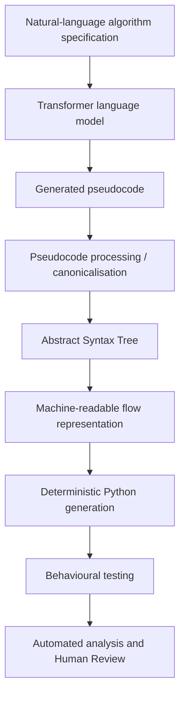

# NL-FDEP v4.38

**Natural Language → Flow Diagram → Executable Python Pipeline**  
**MSc Computer Science Final Project**

NL-FDEP is a controlled, multi-stage research pipeline for transforming structured pseudocode into formal intermediate representations, executable Python and behavioural evidence. It was developed to support comparative evaluation of transformer-based language models while retaining enough intermediate artefacts to identify where semantic or structural divergence first becomes visible.

The principal pipeline is:



A second controlled route accepts a structured draw.io flow diagram and continues from the graph representation into Python generation and testing.

> **Core design rule:** representational form may be normalised, but algorithmic meaning must not be invented.

---

## Repository

Project repository:

```text
https://github.com/ajohnson-2210/Final_Project
```

For academic use, record the exact NL-FDEP version used. The comparative dissertation study was frozen under **v4.37**. **v4.38** is the subsequent/current maintenance release described below.

---

## What v4.38 Contains

The v4.38 project root contains the PyCharm runner and grouped implementation components:

```text
NL_Flow_Diagram_Encoder_Pipeline_v4_38/
├── pycharm_runner.py
├── requirements.txt
├── requirements-optional.txt
├── VERSION
├── pytest.ini
│
├── parser components/
├── compiler components/
├── flow diagram components/
├── pipeline components/
├── study components/
├── cli components/
│
├── study data/
├── tests/
├── examples/
├── docs/
└── README.md
```

`pycharm_runner.py` is the main interactive entry point for normal use in PyCharm. It adds the component directories to `sys.path` automatically, so the grouped folder layout does not need to be manually added to the PyCharm source path.

---

# Using NL-FDEP in PyCharm

The normal development and execution workflow used for NL-FDEP in PyCharm is:

```text
Open the project
      ↓
Open in this window
      ↓
Exclude non-source / generated folders from indexing where appropriate
      ↓
Create a project virtual environment
      ↓
Open pycharm_runner.py
      ↓
Run pycharm_runner.py
      ↓
Choose the required NL-FDEP processing route
```

The following steps describe that workflow in more detail.

---

## 1. Open the Project in PyCharm

Clone the repository or extract the release archive, then start PyCharm and open the NL-FDEP project folder.

Select the **pipeline root folder** containing:

```text
pycharm_runner.py
requirements.txt
requirements-optional.txt
VERSION
```

When PyCharm asks where the project should be opened, choose:

```text
In This Window
```

This keeps NL-FDEP as the active project and ensures that relative paths used by the runner resolve from the expected project root.

Do **not** open one of the individual component directories as a separate PyCharm project. The grouped component directories form part of one NL-FDEP application.

---

## 2. Exclude Folders from PyCharm Indexing Where Appropriate

Before running the project, folders that contain generated artefacts, caches, previous outputs or other material that does not need to be indexed as source code can be marked as **Excluded** in PyCharm.

To exclude a folder:

1. Locate the folder in the **Project** panel.
2. Right-click the folder.
3. Select **Mark Directory As → Excluded**.

This is a PyCharm indexing setting only. Excluding a folder does not delete it and does not prevent NL-FDEP from reading or writing files there when the pipeline uses that path.

Do **not** exclude the implementation component directories required by the runner, including the parser, compiler, flow-diagram, pipeline, study and CLI component folders.

Typical candidates for exclusion are project-local virtual environments, Python cache folders and large generated-output directories that do not need IDE indexing.

---

## 3. Create the Project Virtual Environment

Create a dedicated Python virtual environment for NL-FDEP.

In PyCharm, open the project interpreter settings and create a new virtual environment for the project. A project-local environment such as the following is suitable:

```text
.venv/
```

Use **Python 3.10 or later**.

The selected virtual environment should be the interpreter used to run `pycharm_runner.py`.

A dedicated environment keeps NL-FDEP dependencies separate from the system Python installation and makes it easier to reproduce the project configuration.

---

## 4. Open `pycharm_runner.py`

From the PyCharm **Project** panel, open:

```text
pycharm_runner.py
```

This is the main interactive entry point for normal use of NL-FDEP in PyCharm.

The runner prepares the component import paths automatically, so the individual implementation folders do not need to be manually configured as separate source roots.

---

## 5. Run `pycharm_runner.py`

With `pycharm_runner.py` open:

1. Right-click inside the editor.
2. Select **Run 'pycharm_runner'**.

PyCharm will create a run configuration using the selected project interpreter.

The working directory should be the NL-FDEP project root. If a custom Run Configuration is created manually, use:

```text
Script path:        <project-root>/pycharm_runner.py
Parameters:         <leave blank>
Python interpreter: <project virtual environment>
Working directory:  <project-root>
```

The first NL-FDEP window then asks which processing route should be used:

```text
What would you like to import?

[Pseudocode file]
[Flow diagram file]
[LLM results folder]
[Baseline benchmark folder]
[Human review folder]
```

Select the route required for the current task.

---

## 6. Dependency Handling

The project includes:

```text
requirements.txt
requirements-optional.txt
```

The v4.38 core requirements include the bundled testing dependency:

```text
pytest>=9.0,<10.0
```

Optional benchmark/reference programs may additionally require packages such as:

```text
numpy
matplotlib
```

For the **Baseline benchmark folder** and **LLM results folder** routes, `pycharm_runner.py` checks the relevant requirement files before processing and can offer to install missing packages into the same virtual environment that is running the pipeline.

If dependencies need to be installed manually, use the PyCharm terminal while the project virtual environment is active:

```bash
python -m pip install -r requirements.txt
python -m pip install -r requirements-optional.txt
```

### Tkinter

The interactive runner uses `tkinter` for its route-selection windows and file/folder choosers.

Tk support is normally present in standard Windows Python installations. If the GUI does not open on another platform, confirm that the Python installation includes Tk support.

---

## 7. Output Location

For the normal single-file route, the default output directory is relative to the project working directory:

```python
OUTPUT_DIRECTORY = Path("output")
```

With the project root used as the working directory, generated output is therefore written beneath:

```text
<project-root>/output/
```

Other controlled routes may write their artefacts into the corresponding study or results structure selected by the runner.

---

## Quick PyCharm Workflow

For normal use, the complete sequence is:

```text
1. Open NL-FDEP as a project
2. Choose "In This Window"
3. Exclude non-source/generated folders from indexing where appropriate
4. Create/select the project virtual environment
5. Open pycharm_runner.py
6. Run pycharm_runner.py
7. Select the required import/processing route
8. Select the pseudocode, flow diagram, baseline, LLM-results or Human Review input
9. Inspect the generated artefacts and reports
```

---

# Route 1 — Pseudocode File

Use this route to process one pseudocode file through the main NL-FDEP transformation pipeline.

## Supported file types

The file chooser accepts:

```text
.aj
.txt
```

## Select a pseudocode processing profile

NL-FDEP asks:

```text
How should the pseudocode be processed?
```

Three profiles are available.

### AJ Dialect — strict

Use this for pseudocode already written in the controlled AJ dialect.

The strict profile performs only non-semantic surface cleanup such as line-ending normalisation, trailing-whitespace cleanup and supported representation normalisation.

This profile is appropriate when the input is already intended to conform to the controlled dialect.

### Generic — convert compatible syntax

Use this for structured pseudocode that may contain compatible non-AJ forms.

The Generic Compatibility layer recognises a controlled range of alternative syntax and canonicalises it into the accepted representation without deliberately inventing algorithmic behaviour.

This is the profile normally relevant when processing language-model-generated pseudocode that may vary in surface form.

### General — parse without conversion

This passes the selected source to the lexer/parser without compatibility conversion.

Use it when you specifically want to determine whether the supplied text is directly accepted by the parser without canonicalisation.

---

## Pseudocode processing sequence

A successful pseudocode run follows the principal route:

```text
Pseudocode
   ↓
Processing / canonicalisation
   ↓
AST
   ↓
Flow graph
   ↓
Python
   ↓
Behavioural test harness
   ↓
Pipeline report
```

Python is generated from the **flow representation**, not directly from the original pseudocode.

This is an important architectural boundary because it ensures that the flow representation is a genuine executable intermediate stage rather than a presentation-only diagram.

---

## Single-file outputs

The default runner writes artefacts into:

```text
output/
```

Typical outputs include:

```text
output/
├── processed_pseudocode.aj
├── pseudocode_processing_report.json
├── ast.json
├── parser_report.json
├── ast_visualisation.html
├── flow_diagram.json
├── flow_diagram.html
├── flow_diagram.drawio
├── generated_program.py
├── compilation_report.json
├── test_report.json
└── pipeline_report.json
```

The processing report records which pseudocode profile was used and which transformations, if any, were applied.

---

# Route 2 — Flow Diagram File

Use this route when the algorithm already exists as a structured draw.io-compatible flow diagram.

## Supported file types

The chooser accepts:

```text
.drawio
.xml
.svg
```

The flow-input route validates the supplied graph before Python generation.

Conceptually:

```text
Structured Flow Diagram
        ↓
Machine-Readable Graph
        ↓
Graph Validation
        ↓
Python Generation
        ↓
Behavioural Testing / Syntax Validation
```

The route supports controlled linear diagrams and general control-flow graphs, including decisions, branch joins and loop-back connectors where represented by the supported graph convention.

When an imported graph does not have an associated behavioural oracle, successful compilation can be reported with behavioural testing **SKIPPED** rather than incorrectly comparing the diagram against unrelated expected output.

For imported flow diagrams, the pipeline can also generate Python-AST evidence from the compiled program, including:

```text
ast.json
ast_adjacency_list.json
ast_visualisation.html
generated_program.py
```

The supplied Tic-Tac-Toe flow example demonstrates the alternative structured-flow route used during validation.

---

# Route 3 — Baseline Benchmark Folder

Use this route to establish the trusted study-readiness baseline.

The Baseline route automatically uses the controlled strict profile:

```text
AJ_DIALECT_STRICT
```

## Required baseline layout

Select the **Baseline root folder**, not its `pseudocode` or `python` child individually.

Expected structure:

```text
Baseline/
├── pseudocode/
│   ├── Algorithm - 1/
│   │   └── Algorithm 1 Pseudocode.txt
│   ├── Algorithm - 2/
│   └── ...
│
├── python/
│   ├── Algorithm - 1/
│   │   ├── Algorithm 1 Python.py
│   │   └── Algorithm 1 Tests.json
│   ├── Algorithm - 2/
│   └── ...
│
└── study_analysis/
```

The study uses 50 algorithm folders.

## What happens

After the baseline folder is selected, NL-FDEP:

1. verifies the active Python environment;
2. validates the packaged Common Tests resource;
3. processes the baseline pseudocode through the pipeline;
4. compares the generated behaviour with the trusted baseline evidence;
5. records calibration artefacts; and
6. determines whether the baseline is study-ready.

The baseline is a **readiness control**, not a runtime oracle for experimental LLM outputs.

## Study-readiness requirement

The v4.38 runner requires:

```text
50/50 baseline algorithms pipeline-successful
```

and every behaviourally evaluable baseline calibration must achieve:

```text
100%
```

A case explicitly classified as not behaviourally evaluable does not create an invented behavioural score.

## Session behaviour

When a standalone baseline run becomes study-ready, it remains active **in memory for the current runner session** and NL-FDEP returns to the main options menu.

You can then select **LLM results folder** without choosing and recalibrating the baseline again during that same live runner process.

Orderly exit clears the external baseline recovery hint. A hint left by an unexpectedly terminated process is only a recovery suggestion and is never silently activated on a later run.

---

# Route 4 — LLM Results Folder

Use this route to process a complete language-model dataset.

The dissertation study used six model datasets, each containing 50 algorithms.

## Accepted folder locations

The LLM selector accepts either:

1. a directory that directly contains `Algorithm - n` folders; or
2. an outer model directory containing a `Results` child that contains those folders.

For example:

```text
Model Name/
└── Results/
    ├── Algorithm - 1/
    │   └── Algorithm 1 Pseudocode.txt
    ├── Algorithm - 2/
    ├── Algorithm - 3/
    └── ... Algorithm - 50/
```

A typical processed dataset becomes:

```text
Model Name/
└── Results/
    ├── Algorithm - 1/
    │   ├── Algorithm 1 Pseudocode.txt
    │   └── pipeline_artifacts/
    │       ├── manifest.json
    │       ├── processed_pseudocode.aj
    │       ├── pseudocode_processing_report.json
    │       ├── ast.json
    │       ├── parser_report.json
    │       ├── flow_diagram.json
    │       ├── flow_diagram.html
    │       ├── flow_diagram.drawio
    │       ├── generated_program.py
    │       ├── compilation_report.json
    │       ├── test_report.json
    │       ├── pipeline_report.json
    │       └── scoring/
    │           ├── automated_score.json
    │           ├── scoring_evidence.json
    │           ├── human_review_questionnaire.json
    │           ├── human_review_questionnaire.html
    │           ├── human_review.json
    │           └── final_score.json
    │
    └── study_analysis/
        ├── study_preflight.json
        ├── study_preflight.csv
        ├── batch_report.json
        ├── batch_report.csv
        ├── algorithm_scores.csv
        ├── criterion_evidence.csv
        ├── review_queue.csv
        ├── flowchart_impact.csv
        └── human_review_status.csv
```

## Baseline gate

LLM processing requires a study-ready baseline.

If a suitable baseline is already active in the current runner session, it is reused as the readiness gate.

If no baseline is active, the runner asks you to establish one before the LLM dataset is processed.

The baseline path is used for readiness control and to prevent accidentally selecting the baseline itself as an LLM dataset. It is not passed into experimental scoring as a runtime behavioural oracle.

## Select the pseudocode profile

Before the LLM study session begins, choose the processing profile appropriate to the dataset.

For model-generated pseudocode that requires controlled compatibility conversion, select:

```text
Generic — convert compatible syntax
```

Use a different profile only when the dataset was deliberately produced for that profile.

## After one model dataset completes

NL-FDEP displays:

```text
What would you like to do next?

[Choose another LLM results folder]
[Proceed with human evaluation]
[Quit]
```

This allows multiple model datasets to be processed in the same session while retaining the active baseline readiness state.

---

# Route 5 — Human Review Folder

Human Review is an independent evidence stream used to inspect generated artefacts against the defined review criteria.

Selecting **Human review folder** offers two startup modes:

```text
[Detect previous study]
[Start fresh]
```

## Detect previous study

If a completed experimental study has previously been remembered, NL-FDEP rebuilds the available AI-agent dataset list from completed artefacts on disk and can open the Human Review workflow without requiring the anchor folder to be selected again.

This Human Review pointer is separate from the baseline session-state mechanism and does not activate a baseline or affect scoring.

## Start fresh

Select an LLM model folder or its `Results` folder. Additional datasets can then be added from within the review workflow.

Human Review operates on the retained experimental artefacts and does not rewrite the original model-generated pseudocode.

---

# Common Tests

v4.38 retains the frozen **Common Tests v1.4.2** study instrument.

The packaged resource contains:

```text
50 suites
156 declared test cases
```

The study categories are:

| Category | Declared cases | Purpose |
|---|---:|---|
| Core Behavioural | 129 | Main behavioural evaluation surface |
| Pre-Freeze Validation | 8 | Validation evidence retained outside the frozen core score |
| Semantic Boundary Probe | 19 | Descriptive behaviour outside/at the semantic contract boundary |
| **Total** | **156** | |

Semantic Boundary Probe outcomes are intentionally kept separate from the Core Behavioural score.

Passing all supplied tests is evidence for the exercised contract; it is not formal proof of universal program correctness.

---

# Running the Regression Tests in PyCharm

## Pytest

From the project-root terminal:

```bash
python -m pytest
```

To run only the v4.38 release regression:

```bash
python -m pytest tests/test_release_v4_38.py -q
```

The packaged v4.38 release test has been verified independently from the project root:

```text
2 passed
```

You can also right-click the `tests` directory in PyCharm and select **Run 'pytest in tests'** when PyCharm has pytest support configured for the project interpreter.

## Unittest

The repository also supports the standard-library discovery route:

```bash
python -m unittest discover -s tests -v
```

The v4.38 release validation record documents:

```text
pytest:   1371 passed, 3 skipped, 5 subtests passed
unittest: 468 passed, 1 skipped
checksums verified: 1076
```

Exact output can vary if optional external research resources are not present; corpus-dependent checks are designed to skip cleanly when their external data is unavailable.

---

# v4.38 Release Update

NL-FDEP v4.38 supersedes v4.37 at the code-maintenance level while retaining the same frozen study instrument:

```text
Common Tests:       v1.4.2
Test-spec schema:   v1.6
AJ dialect:         v1.5
Scoring Rubric:     v1.1
Scoring schema:     v1.5
```

## Explicit `PROCEDURE` declarations after study headers

The principal v4.38 fix concerns Generic Compatibility source-boundary detection.

A model result could contain a leading study/title block followed by an explicit procedure declaration, for example:

```text
# Algorithm 47: Update inventory quantities
PROCEDURE updateInventory(inventory_map, transactions):
    ...
END PROCEDURE
```

In v4.37, the leading-header detector recognised `FUNCTION` as the beginning of executable pseudocode but omitted the equally explicit `PROCEDURE` keyword.

As a result, the header-removal stage could remove both the title block **and the `PROCEDURE` opener**. The existing later conversion of:

```text
END PROCEDURE
```

into:

```text
ENDFUNCTION
```

could then leave an unmatched terminator and prevent AST construction.

v4.38 adds `PROCEDURE` to the pseudocode-start detector. The supplied declaration is therefore preserved and reaches the existing Generic Compatibility conversion:

```text
PROCEDURE name(args)
```

→

```text
FUNCTION name ACCEPTS(args)
```

No parameters, return behaviour, calls, state changes or other algorithmic semantics are invented by this fix.

## Resume compatibility

v4.38 can resume semantically unchanged v4.37 LLM artefacts when the normal source, test, rubric, profile and dependency fingerprints still match.

Selective legacy invalidation is limited to artefacts whose own recorded stripped source prefix shows that an explicit `PROCEDURE` declaration was removed.

Reviewed artefacts retain the existing review-protection behaviour.

Semantically compatible v4.36/v4.37 baseline calibration artefacts can also be accepted when their released fingerprints match.

## What v4.38 does not change

v4.38 does **not** change:

- the frozen Common Tests v1.4.2 resource;
- compiler semantics;
- the DrawIO layout revision;
- the scoring methodology; or
- the experimental semantic contract.

The DrawIO layout revision remains:

```text
v4.37-layout-20260922-1
```

For reproduction of the dissertation's frozen comparative results, retain the original **v4.37 study artefacts and conditions**. Use v4.38 for subsequent pipeline work unless the objective is exact historical reproduction of the v4.37 experiment.

---

# Useful PyCharm Settings

## Stop automatic output-window clutter

The runner currently defines:

```python
OPEN_VISUALISATIONS = True
```

This allows generated HTML visualisations to open automatically where supported.

For runs where you only need the artefacts and do not want visualisations opened automatically, this constant can be changed locally to:

```python
OPEN_VISUALISATIONS = False
```

Do not change this setting during a frozen experiment unless the change is documented as part of the run configuration.

## Terminal interpreter check

If PyCharm appears to install packages into the wrong environment, run:

```bash
python -c "import sys; print(sys.executable)"
```

The path should match the interpreter configured in the PyCharm project.

---

# Troubleshooting

## The NL-FDEP window does not appear

Check that:

- `pycharm_runner.py` is being run rather than a component module;
- the PyCharm run configuration uses the intended interpreter;
- Tkinter is available;
- the program is being run in a desktop session that permits GUI windows; and
- the main window has not opened behind PyCharm.

## Outputs are written to an unexpected folder

Check the **Working directory** in the PyCharm Run Configuration.

It should be the project root containing `pycharm_runner.py`.

## Baseline processing will not start

The Baseline route expects a root with both:

```text
pseudocode/
python/
```

and the expected `Algorithm - n` structure beneath them.

It also verifies the active environment against both dependency files.

## The baseline is not study-ready

The runner requires 50/50 baseline pipeline successes and 100% on every behaviourally evaluable calibration.

Read the generated baseline artefacts and the error dialogue rather than manually overriding the readiness gate.

## LLM results cannot be selected

Select either:

- the directory containing the `Algorithm - n` folders directly; or
- the model directory containing a `Results` child with those folders.

Do not select the trusted Baseline folder as the experimental dataset.

## NumPy or Matplotlib is reported missing

Install the optional benchmark requirements into the same interpreter used by PyCharm:

```bash
python -m pip install -r requirements-optional.txt
```

The optional packages are required by frozen benchmark/reference behaviour including Algorithm 50.

## Research corpus tests are skipped

The complete six-model research corpus is intentionally external to the versioned implementation ZIP.

Some integration checks can use an external corpus directory when the environment variable below is defined:

```text
AJ_RESEARCH_CORPUS_DIR
```

If it is absent, corpus-dependent checks skip rather than inventing substitute data.

---

# Design Boundaries

Several boundaries are deliberate and should be preserved when extending NL-FDEP.

### AST is not an external input route

The AST is an internal intermediate representation. The normal external routes are pseudocode, structured flow input, Baseline dataset, LLM dataset and Human Review dataset selection.

### Python is generated from flow

The pseudocode pathway is intentionally:

```text
Pseudocode → AST → Flow Representation → Python
```

Generating Python directly from pseudocode would bypass the flow representation and weaken the semantic-preservation experiment.

### Baseline is not the experimental runtime oracle

The trusted baseline establishes that NL-FDEP can process the benchmark under trusted conditions. Experimental correctness is evaluated through the frozen test/evaluation procedures.

### Canonicalisation is constrained

Canonicalisation may make supported representation explicit. It must not repair an incorrect algorithm by inventing missing algorithmic behaviour.

---

# Research Context

The comparative study evaluated six transformer-based language-model datasets:

- ChatGPT 5.5
- Claude sonnet 4.6
- Deepseek
- Gemini 3 flash
- Groq llama-3.3-70b-versatile
- Qwen 3.6 plus

Each dataset contains the same 50 natural-language algorithm tasks, producing 300 model-algorithm observations in the complete comparative experiment.

The software and retained artefacts support separate analysis of pipeline processability, behavioural evidence, intermediate representation preservation, automated assessment and independent Human Review.

---

# Citation

If citing the project repository in academic work, a suitable repository citation is:

> Johnson, A. (2026) *Final_Project: NL-FDEP – Natural Language–Flow Diagram Execution Pipeline* [GitHub repository]. GitHub. Available at: https://github.com/ajohnson-2210/Final_Project

Where the experimental methodology or results are used, cite the associated MSc research report as well as the software repository.

---

# Quick Start Summary

```text
1. Open the NL-FDEP root folder in PyCharm.
2. Select/create a Python 3.10+ virtual environment.
3. Install requirements.txt and requirements-optional.txt.
4. Ensure the Run Configuration working directory is the project root.
5. Run pycharm_runner.py.
6. Select one of the five controlled routes.
7. Follow the file/folder chooser and profile prompts.
8. Inspect generated artefacts rather than relying only on the final Python output.
```

For a first smoke test, the simplest route is:

```text
Run pycharm_runner.py
→ Pseudocode file
→ choose the appropriate processing profile
→ select a small .aj or .txt example
→ inspect output/pipeline_report.json
→ inspect output/generated_program.py
→ inspect the AST and flow visualisations
```

For a complete comparative study session:

```text
Run pycharm_runner.py
→ Baseline benchmark folder
→ establish study-ready baseline
→ return to main menu
→ LLM results folder
→ choose processing profile
→ process model dataset
→ choose another LLM dataset or proceed to Human Review
```

---

**NL-FDEP v4.38**  
Natural Language → Controlled Pseudocode → AST → Flow Representation → Python → Testing → Analysis
